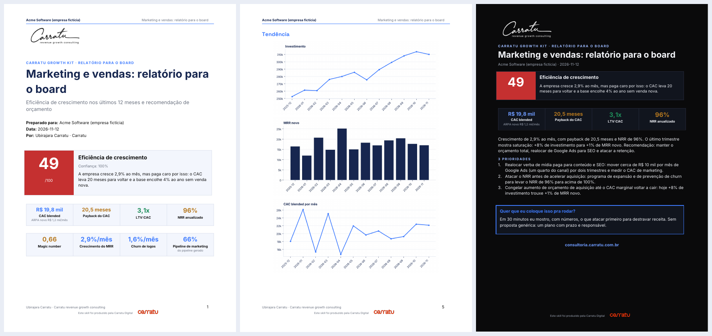

# Relatório para o board · Board-ready growth report

**Carratu Growth Kit** · Skill para o Claude · por [Ubirajara Carratu](https://www.linkedin.com/in/carratu) ·
[Carratu revenue growth consulting](https://consultoria.carratu.com.br) · v1.0.0 (nov/2026)



## PT-BR

O board não pergunta quantos cliques a campanha teve. Pergunta quanto custa trazer um real de receita recorrente, em
quanto tempo ele se paga, se a base cresce sozinha e se o próximo real investido rende como o anterior. Esta skill
traduz marketing e vendas para essa língua, com números calculados e uma recomendação de orçamento com valores.

### O que ela entrega

- **Unit economics**: CAC blended e de marketing, ARPA novo, payback do CAC, LTV, LTV:CAC, churn de logos.
- **Eficiência marginal**: magic number e últimos 3 meses contra os 3 anteriores (o próximo real rende como o anterior?).
- **Retenção**: NRR anualizado e MRR de expansão.
- **Funil mensal** com conversões e **pipeline por real investido**; parcela do pipeline originada por marketing.
- **Eficiência por canal**: custo por lead, por oportunidade, CAC de marketing e participação no MRR novo.
- **Nota de eficiência de crescimento 0-100** com faixas de mercado ajustáveis e **recomendação de orçamento**.
- Relatório completo e **folha de rosto de 1 página** para a reunião, em DOCX e PDF com a marca Carratu.

### Como usar

> "Monte o relatório de marketing e vendas para o conselho com esta planilha"
> "Qual é o nosso CAC e payback? Vale aumentar o orçamento de mídia em 2027?"
> "Compare a eficiência dos canais e diga onde pôr o próximo real"

Instalação: baixe o ZIP e envie em **Configurações → Capacidades → Skills** no Claude. O modelo de planilha está em
`references/data-model.md`. Exemplo completo (dados fictícios) em [`examples/`](examples/).

## EN

Turns marketing and sales data into board language: blended and marketing CAC, payback, LTV:CAC, annualized NRR, magic
number, MRR growth, funnel and pipeline per dollar, channel efficiency, a 0-100 growth-efficiency score and a budget
recommendation with numbers. DOCX/PDF plus a one-page cover sheet. Ask in English for English output.

## Estrutura · Structure

```
carratu-relatorio-board/
├── SKILL.md
├── references/  data-model.md (colunas e fórmulas) · rubric.json · report-schema.md
├── scripts/
│   ├── board.py          unit economics, eficiência marginal, canais, notas e blocos do relatório
│   ├── make_sample.py    18 meses fictícios de um SaaS B2B
│   └── carratu_*.py      dados, gráficos e relatório (comuns ao kit)
├── assets/
└── examples/
```

## Carratu Growth Kit

| Skill | Para quê · What for |
|---|---|
| [carratu-diagnostico-funil](https://github.com/biracarratu/carratu-diagnostico-funil) | Onde o funil vaza e quanto do pipeline é real |
| [carratu-ai-share-of-voice](https://github.com/biracarratu/carratu-ai-share-of-voice) | Quanto a sua marca aparece nas respostas das IAs |
| [carratu-icp-reverso](https://github.com/biracarratu/carratu-icp-reverso) | O ICP real, a partir de quem de fato compra |
| [carratu-abm-plays](https://github.com/biracarratu/carratu-abm-plays) | Contas em tiers, sinais de compra e plays de ABM |
| [carratu-briefing](https://github.com/biracarratu/carratu-briefing) | Briefing com escuta ativa antes de produzir |
| [carratu-relatorio-board](https://github.com/biracarratu/carratu-relatorio-board) | Marketing e vendas na língua do CFO |
| [carratu-diagnostico-seo-geo-aeo](https://github.com/biracarratu/carratu-diagnostico-seo-geo-aeo) | Visibilidade no Google e nas IAs |

## Licença · License

PolyForm Noncommercial 1.0.0: uso livre para fins não comerciais, inclusive dentro da sua empresa; uso comercial (vender
serviços feitos com a skill, embutir num produto pago) exige licença em
[consultoria.carratu.com.br](https://consultoria.carratu.com.br). Marcas e logos Carratu não estão incluídas. Detalhes
em `NOTICE.md`. Free for noncommercial use; commercial use requires a license.
